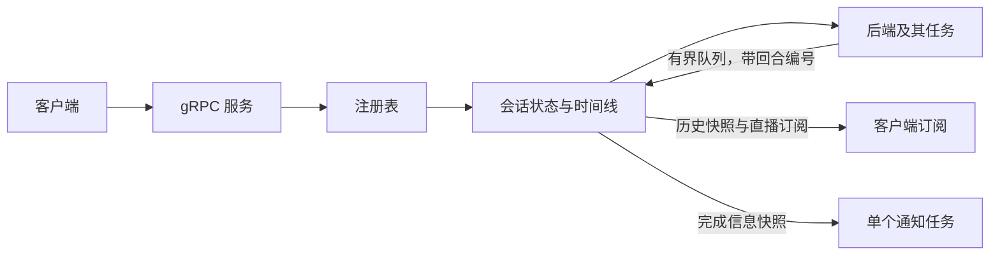

# basrd 框架修订（2026-09-13）

9 月 11 日迁移时发现的会话正确性和任务生命周期问题已处理。守护进程专用实现仍放在
`src/bin/basrd`；公共库只导出模型、protobuf 协议及转换、客户端连接和共用默认值。

本轮采用的职责划分：

| 已修正的问题 | 当前行为 | 回归验证 |
| --- | --- | --- |
| 游标续传只读取第一页，消费游标提前推进 | 在一次锁内建立历史快照和直播订阅；带游标时回放全部未读保留事件；每次消费后更新游标 | [会话测试](../../src/bin/basrd/session/tests.rs)、[gRPC 测试](../../src/bin/basrd/service/tests.rs) |
| 历史淘汰后仍假装完整续传 | 记录已淘汰的可回放事件位置；过期返回 DATA_LOSS，未来游标返回 INVALID_ARGUMENT；直播与回放共用完整 ACP 更新序列 | 会话测试、gRPC 测试 |
| 游标、元数据和广播顺序可能不同 | 三者在同一个会话锁内更新，订阅也使用这个锁 | 多线程发布顺序测试、并发快照与直播交接测试 |
| 回合重叠、旧回合覆盖新状态 | 会话层生成 TurnId、原子地占用回合；忙碌时拒绝且不写入用户消息；丢弃旧回合更新；停止和失败均为终态 | 会话状态、拒绝消息、迟到更新测试 |
| 通知持有会话，空闲客户端断开后转发任务残留 | 通知只接收元数据快照；一个有界队列和一个通知任务；gRPC 直接返回订阅流，无额外转发任务 | 通知快照释放、阻塞通知取消、空闲流立即 detach 测试 |
| ACP 连接退出、任务错误和 panic 未反映到会话 | 工作任务统一上报失败；发布可回放的 Failed 事件，终止活跃回合，关闭流并释放后端 | [ACP 子进程测试](../../src/bin/basrd/agent/acp/tests.rs)、任务 panic 测试 |
| ACP 思考和回答混合，资源丢失 | 直接传输 ACP SessionUpdate、富内容与配置选项；客户端使用 SDK 合并工具更新 | ACP 编解码、GUI 回放及子进程协议测试 |
| 初始化或取消可能无限等待 | 初始化有可配置超时，取消创建会回收部分启动的进程；已发送的取消在 5 秒内没有完成则终止失败后端 | 初始化超时、创建取消、取消先后顺序及无响应取消测试 |
| 无效环境值阻止有效 CLI 覆盖 | 由 clap 先选择有效来源，再解析；容量和启动超时使用非零类型 | [进程测试](../../tests/daemon.rs) |
| 退出依赖 process::exit，绕过析构 | 先发 STOPPING、停止接收新工作，取消初始化并关闭会话、后端及订阅；整体清理设截止时间，超时返回错误 | 带活跃回合和 gRPC 订阅的 SIGTERM 测试 |

同时收敛了几处不一致：标题归守护进程管理，ACP 会话可以本地改名，重复同名操作不发事件；
`notify=always` 要求通知服务可用，`auto` 允许无桌面运行；systemd 代码只在 Linux 编译；
protobuf 中损坏的工具 JSON、无效状态或缺失的会话 owner 会被拒绝；basrctl 创建会话时发送
客户端自己的绝对工作目录及 owner 元数据。没有实际用途的辅助接口已删除或限制为测试使用。

接口约定有所调整，调用方需要同步：

- `Attach.cursor` 存在时，`replay` 不再限制续传数量；没有 cursor 时，`replay=0` 仍表示仅直播。
- `LoadHistory.after` 缺省表示读取当前保留窗口；显式的 0 表示要求从会话起点恢复，历史已淘汰时会报错。
- protobuf 新增 Failed 事件，回合结束原因新增 `error`。
- 内部后端接口只负责快速提交工作，异步进度必须携带会话层提供的 TurnId。后端任务由
  `AbortOnDropHandle` 管理，正常关闭会等待任务结束，丢弃或取消初始化也会释放任务和进程。
- 权限申请默认拒绝，可以通过 `BASRD_PERMISSIONS=allow` 或 `--permissions allow` 明确启用自动批准。
  这是工具审批策略；后端进程仍以守护进程用户身份运行，不提供文件系统隔离。

测试使用可控的 ACP 协议子进程覆盖成功和故障路径，不依赖已安装的第三方 agent。
真实供应商集成、持久化、交互式审批和终端工具仍是后续功能；嵌入式后端仍为 echo。
队列和历史按事件数量设置上限，尚未实现全局会话数或总字节预算。项目仍是单个 Cargo package，
客户端与守护进程的构建依赖尚未拆成独立 feature 或 workspace crate。
