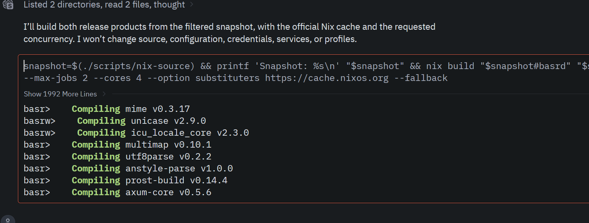

窗口设计
# 组件定制化

考虑到各方的gpui使用者都进行了不同程度的定制化，定制化似乎看起来是可以接受的。但是不要用vendor进来的形式去做。要做就要做一个general的。我们只针对性的解决目前zed家gpui的通用性较差处的问题，并且考虑定期向上游提出合并。

长期目标：我们仍然考虑基于gpui生产更多的native桌面软件。比如文件管理器等，也可以支持sonora之类的音乐播放器的建设。

# 输入框呈现
输入框也是一个很关键的地方，目前做的已经七七八八了。

输入框可能还需要做一些优化

1. 剪贴板，是否对于各个平台的剪贴板支持全面需要检讨
2. 多行输入和单行输入的切换。有时候可能是一些简短提示词，有时候可能是多行，不同的情况下发送方式也要有所改变

## 修改与撤回机制
在缓冲区的消息可以修改或者撤回，缓冲区消息应该放在消息面板的最下方（类似zed agent panel的设计）

也可以立即发送，也就是所谓的打断/发送流程

# thread内容呈现
thread内容呈现的核心应该在于用户的消息和agent返回的结论性blocks

对于工具调用和思考块应该弱化

一个常见的非编码agentic 任务通常可能有这些结构：

1. 用户的一次输入
2. 思考+连续的多次工具调用
3. 输出块

视觉上应当突出用户输入和ai content性质的输出，弱化中间的部分。因此，连续的工具调用应当是可以作为一整个block来折叠的。

简化语言可能是一次思考，n次工具调用之类的hint, just like zed's agent panel.

## markdown渲染
markdown渲染如果long bridge的ui组建库支持不足，可以自己去做一套

作为computer use类的反馈输出可以不那么强调文档式的排版效果。但是对于markdown中的各种结构性要素如多级列表，表格之类的，必须要有比较好的支持

## 特殊渲染
一般来看特殊渲染可能有这么一些需求
1. mermaid，流程图渲染，这个目前好像zed都没有支持，可以后面做
2. diff，一阶段不重要
3. terminal input/output。这个在ccomputer use的场景很重要。可以参考delta的按下`!`切换到一个真实终端的伟大设计。

4. approval 这个比较关键。
5. tex公式，这个离开js似乎比较难办。。。需要考虑rust有没有原生的tex公式渲染库。
6. typst,考虑到可以直接调用库难度应该小于tex,问题是ai不会乐意可能也不是很知道如何输出tex公式，需要实验

待继续补充

# 跨平台
首先支持linux + wayland的环境。其次支持macos/win11, 本身gpui的跨平台能力是有保障的。问题可能在于ui界面的设计。比如wayland下可能不太需要关闭与最大化这些按钮。macos下面可能是信号灯，windows下面的用户比较依赖最大化，缩小，关闭这一组按钮。在wayland下也不好发现尺寸改变导致的显示bug
